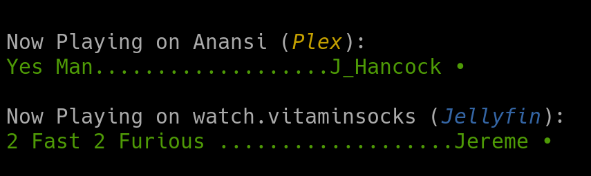
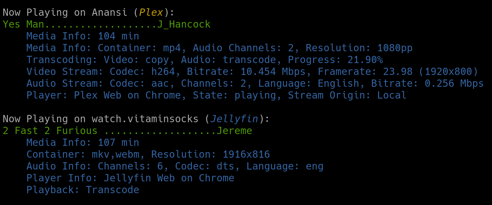

# Ludanta

## Now Playing on Plex/Jellyfin

Ludanta is a lightweight command-line tool that displays what's currently playing on your Plex and/or Jellyfin media servers. Get real-time updates about media playback across your servers directly in your terminal.

## Features
- Real-time playback monitoring for both Plex and Jellyfin servers
- Support for multiple media types (movies, TV shows, music, and live TV)
- Clean, color-coded output for easy reading
- Transcoding status indicators
- Built-in version checking and update mechanism
- Settings can live in a separate settings file, so your token and API key stay out of the script
- Safe updates that keep your settings and never put your token or API key in backups

## ❤️ Support this project

[](https://www.buymeacoffee.com/jeremehancock)

## Screenshots





## Requirements
- curl
- xmlstarlet
- jq
- tput
- Plex and/or Jellyfin server
- Plex token (for Plex monitoring)
- Jellyfin API key (for Jellyfin monitoring)

## Installation

### Quick Start
```bash
mkdir Ludanta && cd Ludanta && curl -o ludanta.sh https://raw.githubusercontent.com/jeremehancock/Ludanta/main/ludanta.sh && chmod +x ludanta.sh
```

### Manual Installation
1. Clone the repository:
```bash
git clone https://github.com/jeremehancock/Ludanta.git
```

2. Change directory:
```bash
cd Ludanta
```

3. Make the script executable:
```bash
chmod +x ludanta.sh
```

## Configuration
There are three ways to give Ludanta your settings. A settings file is recommended.

### Option 1: A settings file (recommended)
Ludanta reads `~/.config/ludanta/config` if it exists. Keeping your settings there means your Plex token and Jellyfin API key are never inside `ludanta.sh` itself, so they stay out of update backups and out of anything you copy or share. Updates never touch this file.

Create it with only the settings you need:

```bash
mkdir -p ~/.config/ludanta
cat > ~/.config/ludanta/config <<'EOF'
PLEX_URL="http://localhost:32400"
PLEX_TOKEN="your-plex-token"
JELLYFIN_URL="http://localhost:8096"
JELLYFIN_API_KEY="your-jellyfin-api-key"
EOF
chmod 600 ~/.config/ludanta/config
```

`chmod 600` makes the file readable only by you.

The settings file is a small shell file, so if you already keep your secrets in a file of your own, it can load that file instead of repeating them:

```bash
# ~/.config/ludanta/config
. ~/secrets/secrets.env                  # a file that sets PLEX_TOKEN and JELLYFIN_API_KEY
PLEX_URL="http://my-server:32400"
JELLYFIN_URL="http://my-server:8096"
```

If your file uses different names, map them: `PLEX_TOKEN="$MY_PLEX_TOKEN"`.

To keep the settings file somewhere else, set `LUDANTA_CONFIG` to its path, for example `LUDANTA_CONFIG=~/ludanta.conf ./ludanta.sh`.

### Option 2: Environment variables
Every setting can also come from an environment variable with the same name:

```bash
PLEX_TOKEN="your-plex-token" ./ludanta.sh
```

### Option 3: Edit the script
You can still type your settings straight into the Configuration section of `ludanta.sh`. Replace the whole value, for example change `PLEX_TOKEN="${PLEX_TOKEN:-}"` to `PLEX_TOKEN="your-plex-token"`. Updates carry these settings over, but they are part of the script, so be careful when copying or sharing it.

### Available settings

```bash
PLEX_ENABLED=true                     # Set to false to disable Plex checking
PLEX_URL="http://localhost:32400"     # Your Plex server URL
PLEX_TOKEN=""                         # Your Plex token (X-Plex-Token)
JELLYFIN_ENABLED=true                 # Set to false to disable Jellyfin checking
JELLYFIN_URL="http://localhost:8096"  # Your Jellyfin server URL
JELLYFIN_API_KEY=""                   # Your Jellyfin API key
```

If the same setting is set in more than one place, this order wins: typed into the script, then the settings file, then environment variables, then the defaults above.

### Finding Your Credentials
- **Plex Token**: Follow the instructions [here](https://support.plex.tv/articles/204059436-finding-an-authentication-token-x-plex-token/)
- **Jellyfin API Key**: In Jellyfin, go to Dashboard → API Keys to generate a new key

## Usage
### Basic Usage
```bash
./ludanta.sh
```

### Command Line Options
```
-v    Show version information
-u    Update to latest version
-d    Show extra details for streams
```

## Output Format
Ludanta displays currently playing media in the following format:
```
Now Playing on SERVER (Plex):
Show Name - Episode Title ................... Username •

Now Playing on SERVER (Jellyfin):
Movie Title ................... Username •
```
The bullet point (•) indicates that transcoding is active for that stream.

You can also use the `-d` flag to give more details for each stream.

## Updates
Ludanta includes an update system that:
- Only updates to a newer version
- Downloads the new version to a separate file first, and checks that it is a complete script, so a failed download never breaks your working copy
- Carries over any settings typed into the script (a settings file is never touched)
- Saves a backup of your previous version in a `backups` folder next to the script, with your Plex token and Jellyfin API key removed

To update:
```bash
./ludanta.sh -u
```

Backups made by versions before 1.2.0 may contain your Plex token or Jellyfin API key. If you have a `backups` folder from an older version, you can delete those backups or keep the folder private.

## Note

Ludanta needs to be on the same network as your Plex Media Server to run. 

If you want to connect remotely you will need to use something like [Tailscale](https://tailscale.com) to ensure that Ludanta can communicate with your Plex Media Server.

## License

[MIT License](LICENSE)

## AI Disclosure

This project was created with the help of AI.
